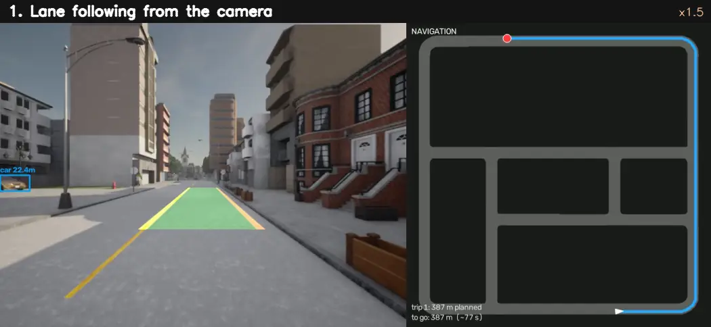
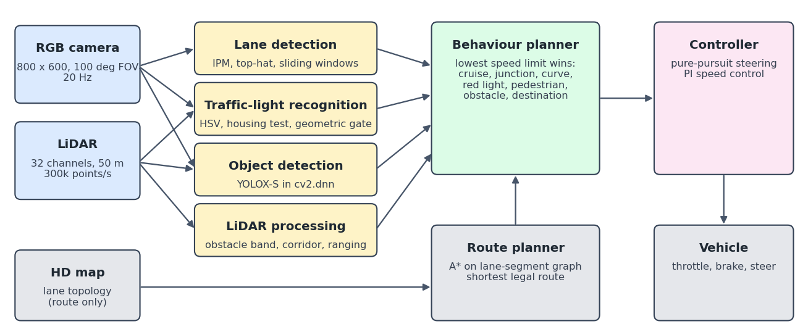
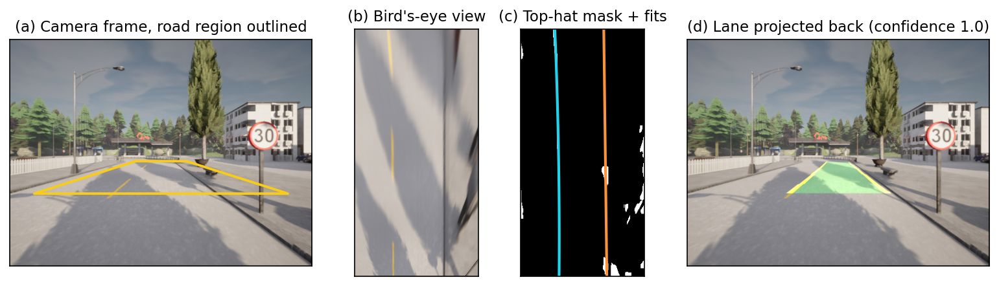
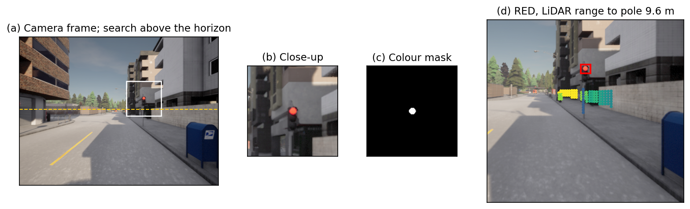
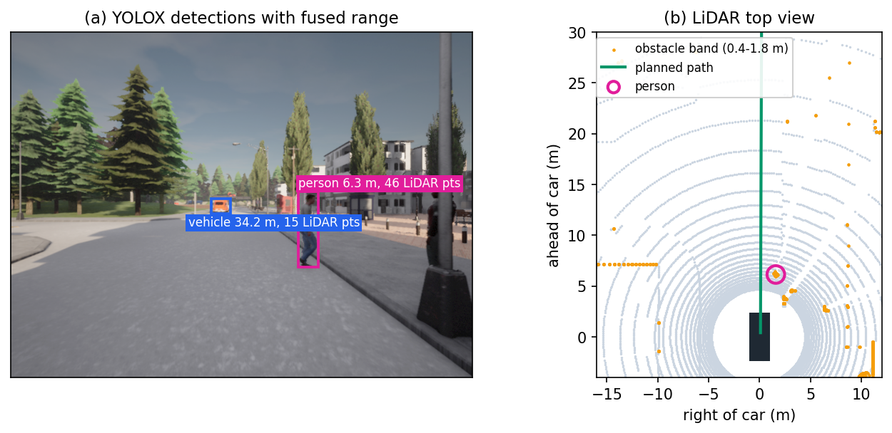
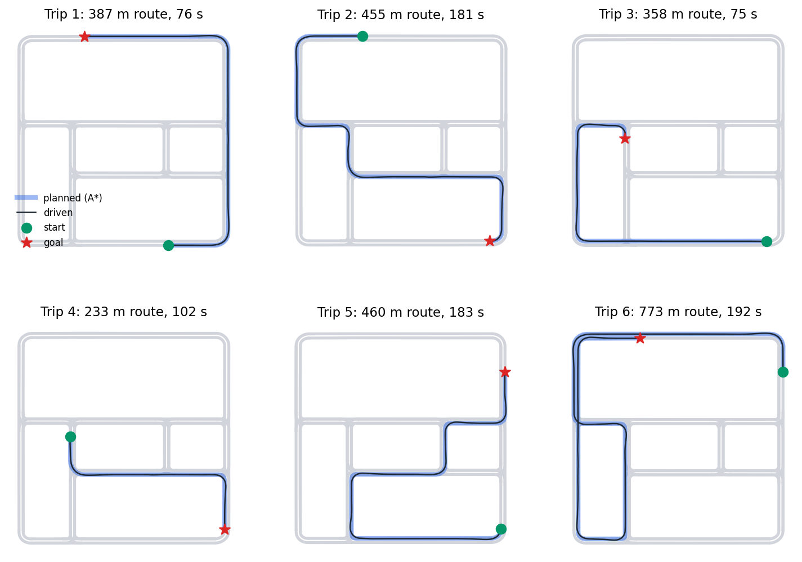
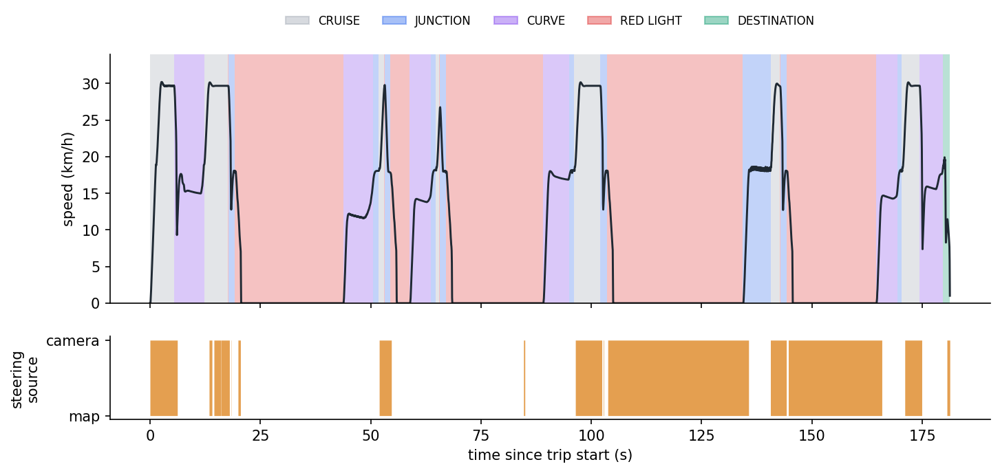
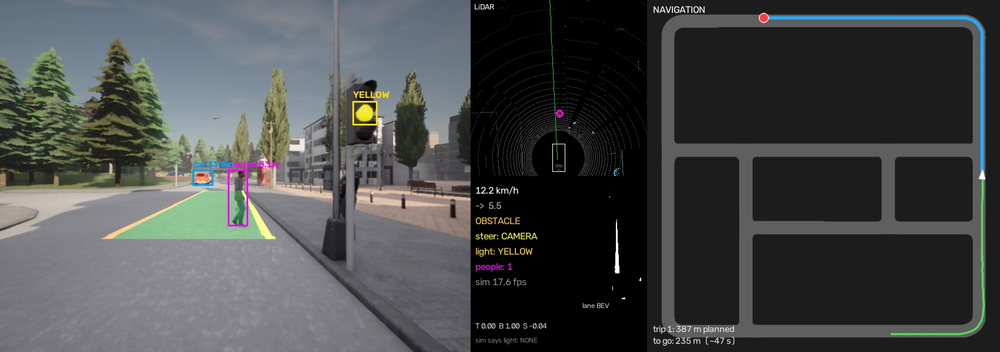

# Autonomous Driving in CARLA with OpenCV, LiDAR and A* Navigation

A self-driving car for the [CARLA](https://carla.org) simulator that **follows lanes, stops at red lights, yields to pedestrians, keeps its distance from traffic and drives itself from point A to point B**, using one camera and one LiDAR. Lanes and traffic lights are detected with classical OpenCV image processing, pedestrians with a YOLOX network running inside OpenCV, and routes are planned with A* search over the road network.

<p align="center">
  
</p>

<p align="center"><em>One navigated trip in Town02: camera view with detections (left) and the live navigation map (right).<br>
Full trip with every panel: <a href="docs/media/full_trip.webm">docs/media/full_trip.webm</a> (34 s, 16 MB)</em></p>

## Results at a glance

Six trips to random destinations, driven back to back in live traffic with pedestrians:

| | |
| --- | --- |
| Trips completed | **6 / 6** |
| Distance driven | **2,592 m** |
| Collisions | **0** |
| Red lights run | **0** (16 red-light stops) |
| Mean stopping error at the goal | **0.16 m** |
| Camera light reading vs. simulator ground truth | **93 %** of frames on signal approaches |
| A* vs. Dijkstra on 1,000 random routes | identical lengths, **39 % fewer** nodes expanded |

The driving code never reads simulator ground truth. A separate scorer compares its decisions against the simulator, so every run prints its own error rates. The complete method, experiments and the eleven failures fixed along the way are written up in the **[technical report](docs/REPORT.md)**.

## What it can do

| Capability | How it works | Sensor |
| --- | --- | --- |
| **Lane following** | Inverse perspective mapping to a bird's-eye view, morphological top-hat filter, sliding-window search, polynomial fit, pure-pursuit steering | Camera |
| **Traffic lights** | HSV segmentation of lit lamps, housing test, geometric relevance gate, 5-frame vote; the stop point is ranged on the pole by LiDAR | Camera + LiDAR |
| **Pedestrians** | YOLOX-S (OpenCV Zoo) in `cv2.dnn`; range from camera geometry, refined by LiDAR; stop or slow by distance to the planned path | Camera + LiDAR |
| **Traffic and obstacles** | Ground removal, then an obstacle corridor along the planned path; gives car following and queueing | LiDAR |
| **Navigation A to B** | A* over a graph of the map's lane segments gives the shortest legal route; click a destination on the map | HD map |
| **Self-evaluation** | Per-run scorecard: collisions, red lights obeyed and run, light-detection agreement, trip table | Simulator (scoring only) |

## How it works



Every 50 ms each rule proposes a speed limit (cruise, junction, curve, red light, pedestrian, obstacle, destination) and the most cautious one wins. Steering follows the camera-detected lane when it is confident and agrees with the map, and the route's waypoints through junctions and tight corners.

<table>
<tr>
<td width="50%"><br><sub><b>Lane detection.</b> Camera frame, bird's-eye view, top-hat mask with fitted lines, lane projected back.</sub></td>
<td width="50%"><br><sub><b>Traffic lights.</b> Search above the horizon, colour mask, LiDAR returns on the pole give the range.</sub></td>
</tr>
<tr>
<td><br><sub><b>Pedestrians.</b> YOLOX detection ranged at 6.3 m, confirmed by 46 LiDAR returns; top view with the planned path.</sub></td>
<td><br><sub><b>Navigation.</b> A* route (blue) and driven trajectory (black) for six trips.</sub></td>
</tr>
</table>

<p align="center"><br>
<sub>Speed over one trip, shaded by the decision in control, and whether the camera or the map supplied the steering target.</sub></p>

## The live display



| Panel | Shows |
| --- | --- |
| Camera | Detected lane (green; yellow edges are detected lines, orange inferred), traffic-light box and state, people (magenta) and vehicles (blue) with fused range |
| LiDAR | Top view: grey = all returns, cyan = obstacle height band, red = points blocking the path, magenta circle = person; then speed, target speed, decision, steering source |
| Navigation | Road network, remaining route (blue), distance driven (green), destination (red), distance and time to go. Click to set a destination |

## Getting started

**Requirements:** Windows 10/11, an NVIDIA GPU with 4 GB or more of VRAM, about 25 GB of disk space, and [Miniconda](https://docs.conda.io/en/latest/miniconda.html). It was developed on an RTX 3050 Ti laptop with 16 GB of RAM.

```powershell
git clone <this repository>
cd <repository folder>
.\setup.ps1              # conda env "carla", YOLOX weights, CARLA 0.9.16 (7.8 GB download)
.\start_server.ps1       # starts CARLA; wait until the town appears
conda activate carla
python main.py --navigate
```

`setup.ps1` creates the conda environment, downloads the detector weights from the OpenCV Zoo and the CARLA 0.9.16 package from the official server, and leaves no archives or pip cache behind. If you already have CARLA 0.9.16, extract it to `simulator/CARLA_0.9.16` instead and run only the first lines of the script.

### Ways to run it

```powershell
python main.py --navigate                 # click a destination on the map panel; Q or Esc quits
python main.py --start 5 --dest 40        # drive between two spawn points, then exit
python main.py --trips 6                  # six random destinations, then a results table
python main.py                            # no destination: wander, random turn at each junction
```

| Option | Effect |
| --- | --- |
| `--seed N` | Different start position, traffic and pedestrians |
| `--frames N` | Stop after N simulation steps (0.05 s each) |
| `--no-display` | Headless; combine with the options below |
| `--video out.mp4` | Record the display |
| `--telemetry run.csv` | Per-frame position, speed, decision, light state, people, free distance |
| `--trips-json trips.json` | Per-trip results |
| `--snapshots DIR`, `--dump DIR` | Periodic display images, or raw camera and LiDAR frames for offline analysis |

Every run ends with a summary such as:

```
===== run summary =====
frames: 16176  (809 s simulated)   distance: 2592 m
steering from camera lanes: 53% of frames (rest: map route)
traffic light camera vs simulator: 93% agreement over 6155 frames
stops for red light: 16   red lights run: 0
frames with a person detected: 3702   stops for pedestrians: 1
collisions: 0 []
```

## Repository layout

```
main.py                 main loop, live display, trips, scorecard
config.py               every tunable parameter in one place
carla_env.py            CARLA world, sensors, traffic and pedestrian spawning
navigation.py           lane-segment road graph, A* planner, map panel
route.py                waypoint route (planned or wandering)
control.py              behaviour rules, pure-pursuit steering, speed control
perception/
  lanes.py              lane detection
  traffic_lights.py     traffic-light recognition
  objects.py            YOLOX person and vehicle detector (cv2.dnn)
  lidar.py              obstacles, ranging, top-view rendering
tools/
  validate_planner.py   A* vs. Dijkstra check, road export
  make_figures.py       regenerates docs/figures
  make_media.py         demo animation and video from a recorded trip
docs/
  REPORT.md             full technical report
  figures/, media/, screenshots/
setup.ps1               one-shot environment and simulator install
start_server.ps1        launches CARLA with settings that are stable on a 4 GB GPU
```

## Hard-won notes

Things that cost the most debugging time, and are worth knowing if you run CARLA 0.9.16 on Windows:

- **Use DirectX 12 and Epic quality.** On NVIDIA driver 616.92, DirectX 11 died on the first camera frame, Vulkan crashed after a few minutes, and `-quality-level=Low` crashed whenever a camera sensor was attached. `start_server.ps1` uses `-dx12 -quality-level=Epic`.
- **Crash stacks point at `FCarlaServer::TickCueReceived`.** That is the game thread's position when the renderer fails, not the cause.
- **4 GB of VRAM is enough for Town02, not for the default Town10HD.** `setup.ps1` sets the default map to Town02 and the texture pool to 1,200 MB (about 2.6 GB used).
- **AI pedestrians are invisible to LiDAR** since CARLA 0.9.15, which disables their collision geometry. `carla_env.py` re-enables it; without that, LiDAR-based ranging of people silently fails.
- **The reported maximum steering angle is the inner wheel's.** The effective angle is about 20% smaller, so pure pursuit needs a gain (1.3 here) or the car runs wide in tight corners.

## Limitations

Tested on one map (Town02), in daylight, at up to 30 km/h. Signal heights and positions are calibrated to Town02's pole-mounted lights. The camera steers on marked roads, while junctions and tight corners use map waypoints; "best route" means shortest distance, not fastest. See section 10 of the [report](docs/REPORT.md#10-limitations-and-next-steps).

## Acknowledgements

- [CARLA](https://github.com/carla-simulator/carla), the open-source driving simulator (MIT licence)
- [OpenCV](https://opencv.org) and the [OpenCV Zoo](https://github.com/opencv/opencv_zoo) for the YOLOX-S detector weights (Apache 2.0)

## Licence

Released under the [MIT licence](LICENSE).
